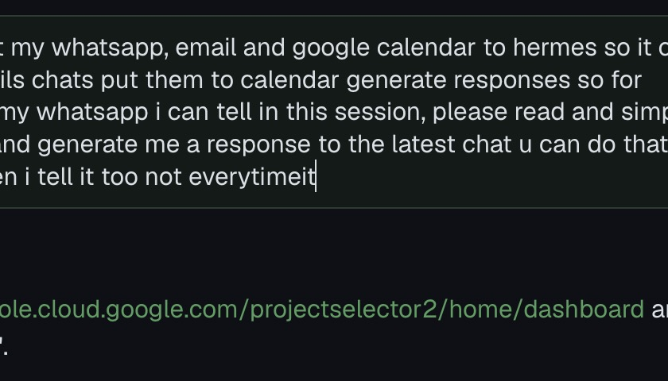

# Glide

**A tiny native menu-bar app that makes a normal mouse wheel scroll like the MacBook trackpad.**

Glide replaces Mac Mouse Fix on one Mac and ships with the same out-of-the-box feel: High smoothness, Medium speed, reversed mouse direction (the wheel scrolls traditionally while the trackpad stays natural), trackpad simulation on, and ⌘ zoom / ⌥ precise / ⇧ horizontal / ⌃ swift modifiers. It has no licence, trial, updater or helper app.



## Features

- **Smooth, inertial wheel scrolling.** Mouse ticks become pixel scroll events with real trackpad phases, so apps do their own rubber-banding and momentum. The trackpad and Magic Mouse pass through untouched.
- **Smoothness** Off / Low / Medium / High, and **Speed** Slow / Medium / Fast.
- **Reverse direction** for the mouse only, plus **trackpad simulation** on or off.
- **Scroll modifiers:** ⌘ / ⌥ / ⇧ / ⌃ can each be Zoom, Precise, Horizontal, Swift or Nothing.
- **Button remaps** for buttons 3/4/5 on click, double-click or hold. Actions: Mission Control, App Exposé, Show Desktop, Launchpad, Back, Forward, Smart Zoom, Middle Click or any keyboard shortcut. Remaps are off by default, and an untouched button is never intercepted.
- **Gestures:** hold a button and drag for three-finger swipes (Spaces, Mission Control). Hold a button and scroll for pinch zoom, Desktop & Launchpad, or moving between Spaces.
- **Per-app exceptions** turn smoothing off in games and similar apps.
- **Launch at login** through SMAppService.

## Requirements

- macOS 14 or later (developed on macOS 27)
- Swift 6 toolchain (Xcode or Command Line Tools)
- Accessibility permission

## Install

```bash
git clone https://github.com/MelvernMogens/glide.git
cd glide
scripts/make-signing-identity.sh      # once per Mac
scripts/build-app.sh --install        # build, sign, copy to /Applications, launch
```

Then turn on **Glide** in System Settings → Privacy & Security → Accessibility. Until you do, the menu shows a single "Allow Glide in Accessibility" line. Glide starts by itself once the permission is granted.

The self-signed identity in `~/.glide-signing` keeps the code signature the same across rebuilds, so macOS doesn't drop the Accessibility grant. Without it, `build-app.sh` falls back to ad-hoc signing and you have to grant Accessibility again after every rebuild.

## How it works

```
 mouse wheel tick (discrete, IsContinuous = 0)
        │
        ▼
 CGEventTap (session, head insert) ── trackpad / Magic Mouse (IsContinuous = 1) ──► untouched
        │  swallow tick, record it in a fixed buffer (no alloc, no lock, no log)
        ▼
 kick run-loop source (same engine thread, right after the callback returns)
        │  TickAccelerator: px/tick from spin speed + fast-scroll ramp
        │  ScrollAnimator: HybridCurve = eased base push → drag-physics inertia tail
        ▼
 CADisplayLink @ display rate ──► pixel scroll events with trackpad phases
                                   Began/Changed → Ended → Momentum → MayBegin+Cancelled
                                   (+ a companion type-29 gesture event, like the trackpad driver)
```

Each tick plans a new curve that carries over what the running one hasn't delivered yet, so distance is never lost or doubled. One notch the other way stops the scroll (throw and catch).

## What this does and does not promise

- The feel numbers (px per tick, curve lengths, drag coefficients, fast-scroll ramp) come from Mac Mouse Fix 3.1's source. Apps with their own momentum engines (Xcode, iPad apps, games) still behave their own way. Use per-app exceptions for games.
- Dock-swipe gestures on macOS 27 depend on a private IOHIDEvent attachment (`SLEventSetIOHIDEvent`), so a macOS update can break them silently. One-shot actions (Mission Control, Show Desktop…) use CoreDock and hold up better.
- The latency number is Glide's own processing time, from the tap callback to the first posted event. Rendering in the target app comes after that and isn't in the number.

Measured on the dev Mac (M-series MacBook, 60 Hz, macOS 27.0.1) with `tools/headless-bench.py`:

| | Result | Budget |
|---|---|---|
| Tap → first event posted | p50 0.11 ms · p99 0.71 ms · max 1.9 ms (n = 330) | < 1 frame (16.7 ms) |
| CPU idle | 0.0 % | ~0 % |
| CPU, continuous scrolling at 33 ticks/s | 1.0–1.7 % | < 3 % |
| Memory (probe / full app with menu) | 7.7 MB / 17 MB footprint | < 30 MB |
| `kill -9` mid-fling | tap count 1 → 0, input back to stock | no stuck tap |

## Stack

| Part | Choice |
|---|---|
| Language / build | Swift 6 toolchain, SwiftPM, language mode 5, no Xcode project, no dependencies |
| Pure logic | `GlideKit` (Foundation only), XCTest unit tests |
| App | AppKit status item + SwiftUI views, CGEventTap, CADisplayLink |
| Private APIs | `dlsym` only: CoreDock, IOHIDEvent, SLEventSetIOHIDEvent, CGS spaces |
| Signing | self-signed identity in `~/.glide-signing` |

## Development commands

| Command | What it does |
|---|---|
| `swift test` | GlideKit unit tests: curves, NaN/clamping, acceleration, modifiers, settings, button state machine |
| `swift build` | Debug build → `.build/debug/Glide` |
| `.build/debug/Glide --probe 30` | Runs the tap headless with the defaults, then prints counters and latency percentiles |
| `Glide --inject 12 0.03 down [continuous] [flags=shift]` | Fake mouse (or trackpad) ticks at the HID level |
| `tools/m1-film.sh x y h label …` + `tools/film-summary.py label` | Films a screen strip while injecting, then measures real on-screen motion |
| `python3 tools/headless-bench.py` | Latency, CPU, RAM and kill-safety checks without touching the screen |
| `python3 tools/m1-live.py all` | Full live proof in Safari, Finder, Hermes, gestures and the menu. Takes over the screen for about 3 minutes |
| `Glide --receiver log.jsonl` | Test window that logs every scroll event's phase, delta and timing |
| `Glide --snapshot out.png` | Renders the dropdown offscreen |
| `Glide --settings` / `--open-menu` | Opens the settings window / pops the dropdown |
| `Glide --login-item on\|off\|status` | SMAppService launch at login, run from the installed bundle |
| `swift scripts/make-icon.swift` | Regenerates the app icon |

## Gotchas worth knowing

- **Synthesized scroll events need a location.** `CGEvent(scrollWheelEvent2Source:)` leaves it at (0,0), and then nothing receives the event. Glide sets the location to the cursor on every event.
- **Off-screen windows ignore scroll events.** A window on another Space or behind a full-screen app gets none, and `postToPid` doesn't help. Real-app tests need the window in front, under the pointer.
- **Natural scrolling is one shared system setting.** "Reverse direction" flips whatever macOS sends, for the mouse only. With Natural on for the trackpad, the wheel scrolls traditionally.
- **macOS 27 dock swipes ignore CGEvent fields.** They only work with an IOHIDEvent attached.

## Status

| Milestone | Status |
|---|---|
| M1: headless tap with smooth, reversed, phased scrolling and the trackpad untouched | done |
| M2: menu-bar dropdown, settings, launch at login | done |
| M3: remaps, drag/scroll gestures, per-app exceptions | done (live gesture check with a real mouse pending) |

This is a personal tool and isn't notarized. The full Mac Mouse Fix feature checklist, with each item ticked or marked as cut, is in [`docs/prd.md`](docs/prd.md).

## Docs

- [`docs/prd.md`](docs/prd.md): scope, the MMF parity checklist and open questions
- [`docs/security.md`](docs/security.md): threat model
- [`docs/m1-live-report.txt`](docs/m1-live-report.txt): live scrolling proof
- [`HERMES.md`](HERMES.md): working notes and commands

## Credits

The scroll feel is modeled on [Mac Mouse Fix](https://github.com/noah-nuebling/mac-mouse-fix) by Noah Nuebling.

---

Built by [Melvern Mogens](https://github.com/MelvernMogens).
